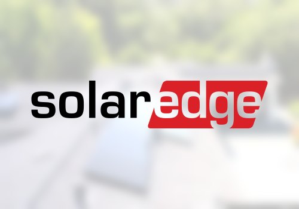

# SolarEdge for Homey

Powering People's Lives Around the World

Connect your SolarEdge installation to [Homey](https://homey.app) and follow your solar production, battery, grid and EV charging live. Use the data in Flows and in Homey Energy.

> **This fork** (app id `bothe.family.solaredge`, a separate app from the store's `com.solaredge`) is R.M. de Gruijter's [com.solaredge](https://github.com/gruijter/com.solaredge) v2.2.0 plus:
>
> - **Solar forecast** on the inverter: expected power now, today and tomorrow (with a low/high range), today against the forecast, projected and remaining today, and its accuracy over the last 30 days. It uses Open-Meteo's weather forecast (no key needed) and learns from the site's own production: a calibration factor, a seasonal profile and an hourly shading profile. Up to three panel groups (count, tilt, direction) are set in the inverter's settings. On a site with several inverters it runs on the one with the lowest serial number. Flow cards: *Tomorrow's solar forecast changed*, *Tomorrow's solar forecast is above…* and *Expected solar power at a time is above…*.
> - **Self-sufficiency and self-consumption (today)** on the meter. Battery energy counts towards self-sufficiency only for the share of the battery's charge that came from solar.
> - **Charged from solar / from grid (today)** on the battery.
> - **Steady power kept current in Homey Energy:** Homey only marks a capability as updated when its value changes, and the Energy tab drops a power that has stayed the same for a while (a battery charging at a constant rate, say). A power held unchanged for 5 minutes is written 1 W towards zero and straight back. 0 W is left alone. A *power changed* Flow runs on both writes.

The app connects in two ways:

- **Cloud:** with your **mySolarEdge** account (the e-mail address and password of the mySolarEdge app). No API key or installer access needed. Works on every Homey, including Homey Cloud.
- **Modbus:** directly to the inverter on your local network. Works only on Homey Pro.

## Supported devices

During pairing, the app only offers the devices your site actually has.

### Cloud

- **Inverter:** one device per inverter: solar power, the energy produced today, this month, this year and in total, and voltage per phase, optimizer temperature and status. SolarEdge reports power and energy for the whole site; with several inverters the app splits them by what each inverter produced.
- **Meter** (sites with a grid meter): home consumption, grid power (import positive, export negative), solar power, and the imported and exported energy for Homey Energy.
- **Battery:** all batteries of a site together, as in SolarEdge's own app: charge and discharge power, state of charge, charging state, state of health, and the energy charged and discharged (grid included) for Homey Energy.
- **EV Charger:** charging power and state, energy charged, and starting and stopping charging from Homey.
- **Home Load Controller:** SolarEdge smart energy switches. You can set them to on, off or auto from the device or from a Flow.

Live power updates every 5 seconds or more, as set in the device settings (the same for all devices of an account). Energy totals update every 5 minutes.

### Modbus

- **Inverter (Modbus):** power, energy, voltage per phase, frequency, temperature and status. You can limit the inverter's output power and the export to the grid.
- **Meter (Modbus):** power and voltage per phase, and the imported and exported energy.
- **Battery (Modbus):** all batteries of an inverter together: charge and discharge power, state of charge, state of health and energy counters. You can control charging and discharging and set the backup reserve, if your inverter has storage control over Modbus:
  - SolarEdge enables battery data over Modbus per inverter. Without it, the battery device cannot be added, or it has no controls. Ask your installer or SolarEdge support to enable it.
  - Charging and discharging from Homey also needs advanced power control in the inverter, and export limitation must be off. Ask your installer to set this up.
- **EV Charger (Modbus):** the SolarEdge Home EV Charger. You can start and stop charging, set the charging power and set an energy limit for a session.

Modbus TCP must be enabled on the inverter (your installer can do this in SetApp). Use only one Modbus client at a time on the same inverter.

## Installation

Install the app from the [Homey App Store](https://homey.app/a/com.solaredge). Add a device. For a cloud device, sign in with your mySolarEdge e-mail and password. For a Modbus device, the app searches your network for the inverter.

## Known limitations

- Cloud login does not work for mySolarEdge accounts that use two-factor authentication (2FA).
- Cloud login does not work for accounts that sign in through a company account (single sign-on).

## Support

Questions and feedback are welcome on the [Homey Community forum](https://community.homey.app/t/134605). Report bugs as a [GitHub issue](https://github.com/gruijter/com.solaredge/issues).

## Credits

Originally developed by Emile Nijssen (Athom). Maintained by Robin de Gruijter.

## License

[GPL-3.0](./LICENSE)
